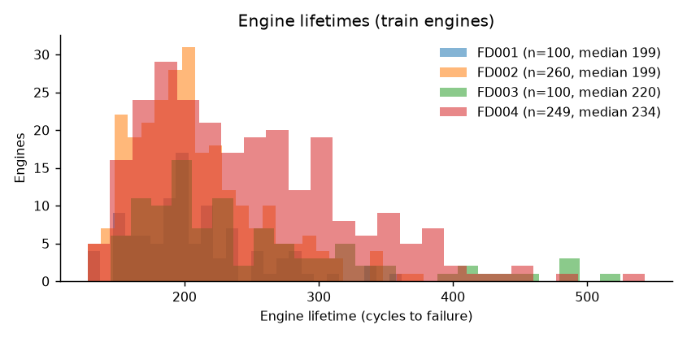
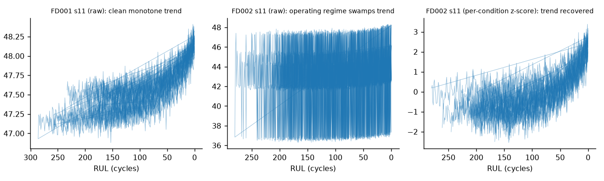
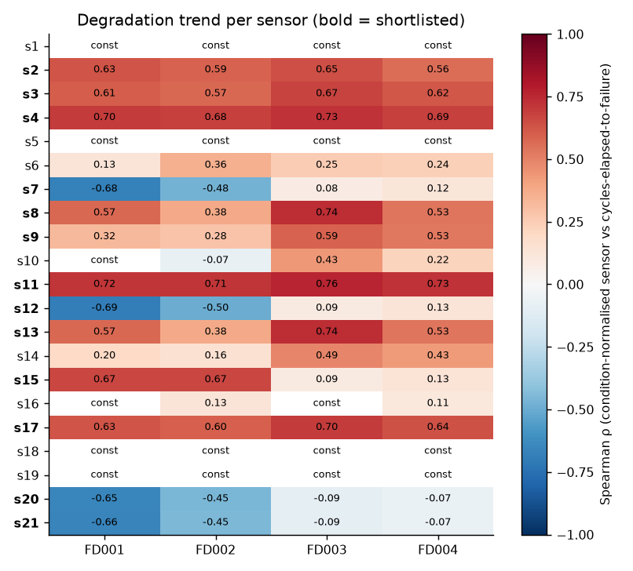
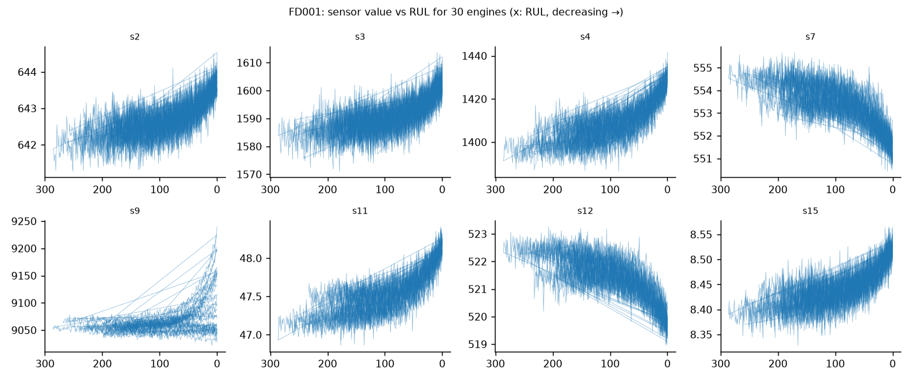

# EDA report (auto-generated by src/eda.py)

## Engine lifetimes (train engines)

| dataset   |   count |   mean |   std |   min |   25% |   50% |   75% |   max |
|:----------|--------:|-------:|------:|------:|------:|------:|------:|------:|
| FD001     |     100 |  206.3 |  46.3 |   128 | 177   | 199   | 229.2 |   362 |
| FD002     |     260 |  206.8 |  46.8 |   128 | 174   | 199   | 230.2 |   378 |
| FD003     |     100 |  247.2 |  86.5 |   145 | 189.8 | 220.5 | 279.8 |   525 |
| FD004     |     249 |  246   |  73.1 |   128 | 190   | 234   | 290   |   543 |

## Constant sensors (zero variance within operating condition)

| dataset   | constant sensors           |
|:----------|:---------------------------|
| FD001     | s1, s5, s10, s16, s18, s19 |
| FD002     | s1, s5, s18, s19           |
| FD003     | s1, s5, s16, s18, s19      |
| FD004     | s1, s5, s18, s19           |

FD002/FD004 sensors are *not* constant in raw form because six operating regimes shift the readings; constancy only shows after per-condition normalisation. In those datasets the raw sensors are dominated by regime, not wear.

## Degradation trends

## Sensor shortlist (13 sensors)

Criteria: not constant; |Spearman ρ| ≥ 0.30 with elapsed life after per-condition normalisation in FD001; same sign in FD002. FD004 is not used in the sign rule because its two fault modes make pooled trends mixed. One common list is required so that models trained on one subset can be applied to another. Several kept sensors (s7, s12, s15, s20, s21) are weak when pooled over FD003/FD004 because the two fault modes degrade different sensors; this is flagged as a likely source of cross-dataset error.

`s2, s3, s4, s7, s8, s9, s11, s12, s13, s15, s17, s20, s21`

Dropped sensors and why:

| sensor   | reason                                 |
|:---------|:---------------------------------------|
| s1       | constant in FD001, FD002, FD003, FD004 |
| s10      | constant in FD001                      |
| s14      | weak trend in FD001 (|ρ|=0.20)         |
| s16      | constant in FD001, FD003               |
| s18      | constant in FD001, FD002, FD003, FD004 |
| s19      | constant in FD001, FD002, FD003, FD004 |
| s5       | constant in FD001, FD002, FD003, FD004 |
| s6       | weak trend in FD001 (|ρ|=0.13)         |

## Issues found

- Engine lifetimes vary widely (FD001: 128–362 cycles), so any fixed interval is wrong for many engines.

- Test engines are truncated at a random point; only the final-cycle RUL is given, so test-set metrics use one row per engine.

- Sensors are noisy; single-cycle readings are weak signals, which motivates rolling-window features.

- FD003/FD004 contain two fault modes; no sensor flags the mode, so it is a latent source of error.
